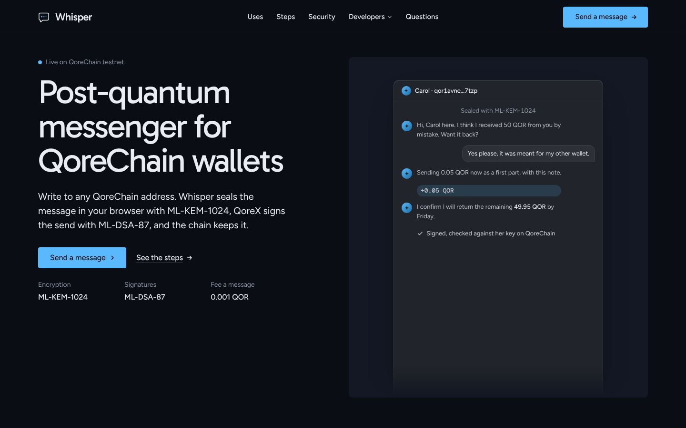
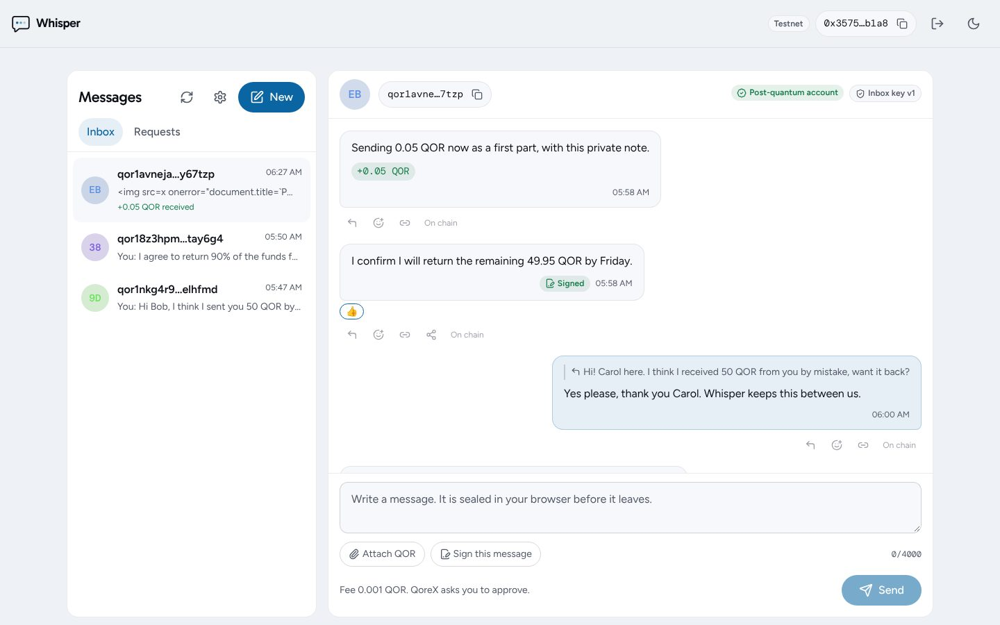
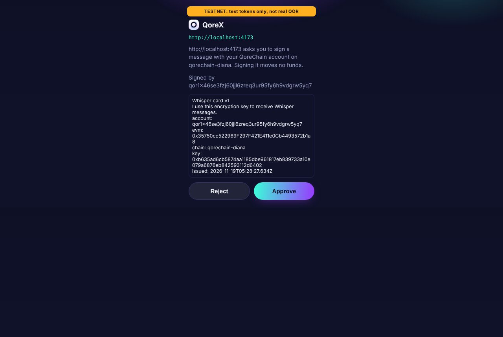
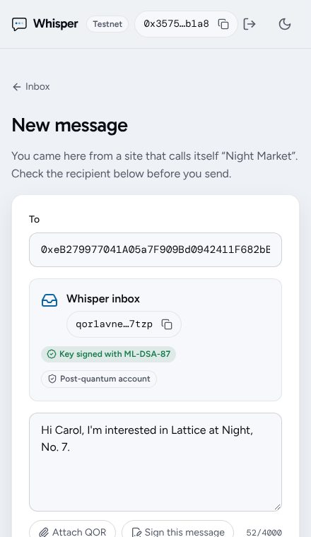
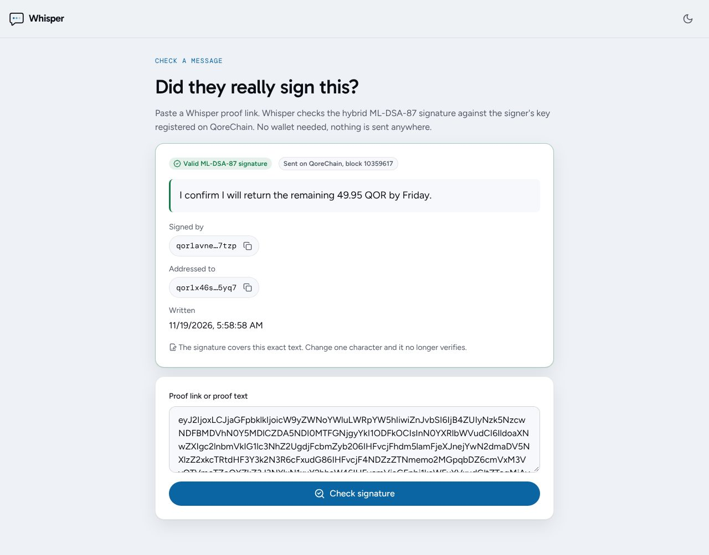
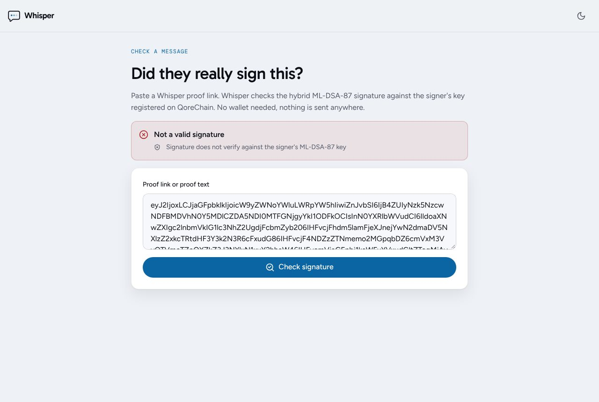
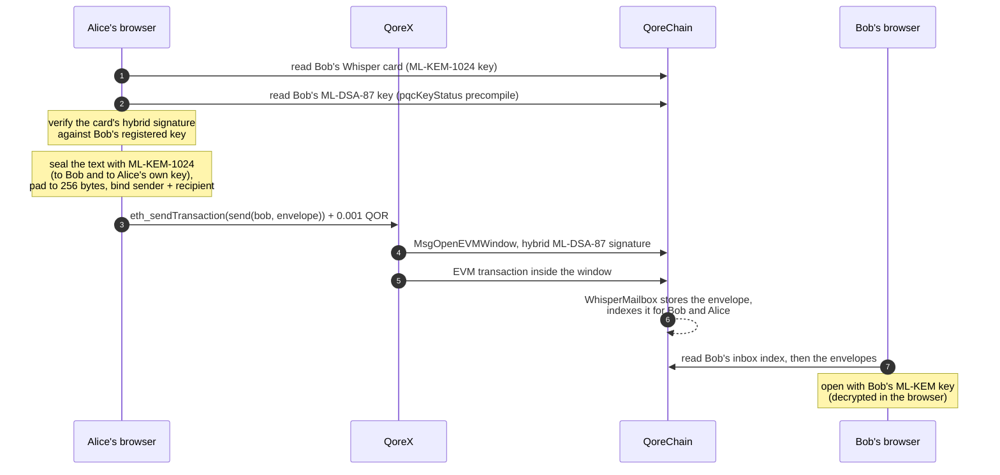
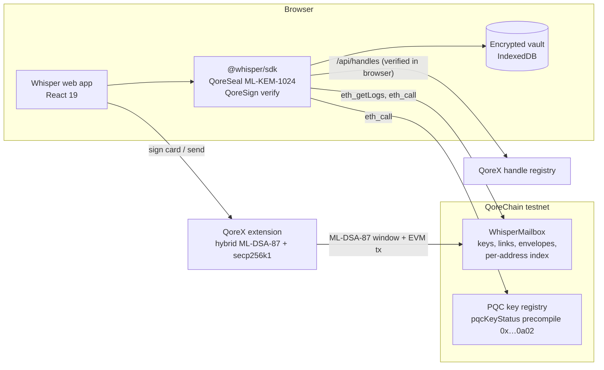
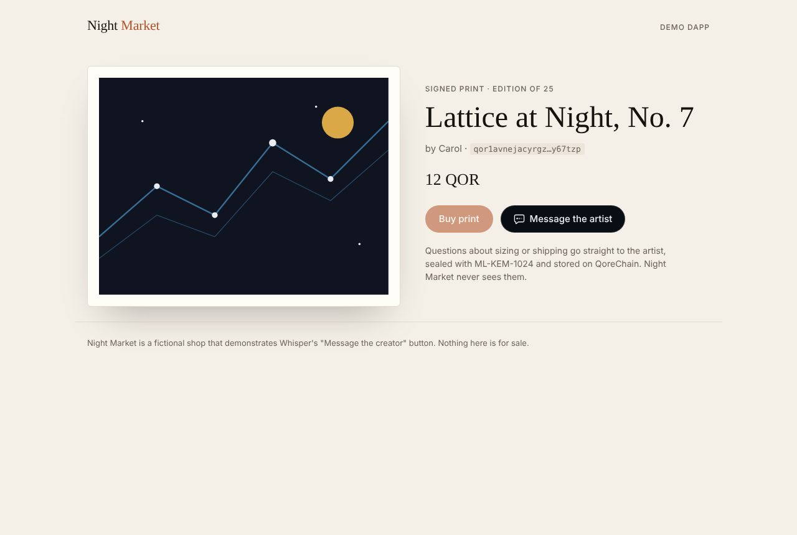

# Whisper

**A post-quantum messenger for QoreChain wallets.** Write to any QoreChain address. Whisper seals the message in your browser with ML-KEM-1024, QoreX signs the send with ML-DSA-87, and the message is stored on QoreChain. There is no server in between.

Built for the QoreChain *Build Before Q-Day* Developer Fest, Encrypted Apps track. Live on QoreChain testnet (`qorechain-diana`).

**Try it: [whisper-qorex.vercel.app](https://whisper-qorex.vercel.app)** · [proof checker](https://whisper-qorex.vercel.app/check) · [demo shop with the message button](https://whisper-qorex.vercel.app/demo/)



| | |
| --- | --- |
| Contract | `WhisperMailbox` at [`0xd837298637f4459a3981b540d5543a4423add801`](https://explore.qore.network/tx/0x24bfeeeccf307279d26eb1400a7b7d0200ba9bf091b89311d940b746fb56e68b) (testnet, block 10350669) |
| Encryption | ML-KEM-1024 through QoreSeal, payload padded to 256-byte blocks |
| Signatures | Hybrid secp256k1 + ML-DSA-87 through QoreX and QoreSign, checked against QoreChain's PQC key registry |
| Wallet | QoreX browser extension (an Ethereum account, coin 60) |
| Fee | 0.001 QOR a message, plus gas |
| Tests | 31 Foundry, 29 SDK, 17 web app; 8 of 8 live classical-key attacks blocked ([audit.md](audit.md)) |

---

## Contents

1. [Why this exists](#why-this-exists)
2. [What it does](#what-it-does)
3. [How it works](#how-it-works)
4. [Architecture](#architecture)
5. [Security](#security)
6. [Message the creator: integrate Whisper in your dApp](#message-the-creator-integrate-whisper-in-your-dapp)
7. [Run it locally](#run-it-locally)
8. [Deploy](#deploy)
9. [Testnet addresses](#testnet-addresses)
10. [Repository layout](#repository-layout)
11. [Limitations](#limitations)
12. [Credits and licence](#credits-and-licence)

---

## Why this exists

A wallet address can receive money from anyone, but nobody can write to it. People work around that today with public transaction data, Discord DMs and screenshots. Four real situations:

**1. "I sent funds to the wrong address."** Wallet support guides say the only fix is to contact the owner of the receiving address, but addresses are anonymous. The usual workaround is a tiny transaction with a note in its data field, which anyone can read. ([MetaMask support](https://support.metamask.io/de/manage-crypto/move-crypto/send/funds-sent-on-wrong-network/), [Polkadot forum](https://forum.polkadot.network/t/sent-to-the-wrong-address/17132))

**2. Negotiating with an exploiter.** After the $197M Euler Finance hack, Euler and the hacker negotiated through messages embedded in public transactions, and Euler had to ask to continue "in private". About $177M came back. A private channel to an address was the missing piece. ([Cointelegraph](https://cointelegraph.com/news/euler-finance-to-enter-talks-with-exploiter-over-the-return-of-funds), [The Block](https://theblock.co/post/224705/euler-hacker-returns-funds))

**3. Private deals between two people.** QoreChain has no token pairs on mainnet yet, and QoreX swaps are switched off, so people who trade directly have to agree terms somewhere. Blockscan Chat was pitched for exactly this, connecting buyers and sellers of NFTs. ([The Defiant](https://thedefiant.io/news/nfts-and-web3/blockscan-chat-ethereum))

**4. Impersonation and scams.** Anyone can copy a name and an avatar. A Whisper message can carry a signature that is checked against the sender's ML-DSA-87 key in QoreChain's own registry, so it proves the message came from that address.

And every one of these channels should still be private after Q-Day. A message encrypted today with classical crypto can be stored now and read later ("harvest now, decrypt later"). Whisper uses ML-KEM-1024 for the content and relies on QoreChain's ML-DSA-87 account keys for who sent it.

## What it does

| | |
| --- | --- |
|  | **Inbox and threads.** Conversations per address, replies, reactions, unread counts and a light and dark theme. Messages are read from QoreChain and opened in your browser. |
|  | **QoreX does the signing.** Setup signs a *Whisper card* that binds your inbox key to your account. Every send is a QoreX transaction inside an ML-DSA-87-signed EVM window. |
|  | **Message the creator.** Any dApp can add a button that opens Whisper addressed to its creator, with a draft. The source site's name is shown as its own claim. |
|  | **Proof links.** Share one signed message with a third party. The `/check` page verifies it with no wallet, against the signer's key on QoreChain. |
|  | **Tampering is caught.** Change "49.95" to "4.95" and the same link says "Not a valid signature". |

Also in the app:

- **Attach QOR** to a message (forwarded by the contract in the same transaction).
- **Sign a message** on request (opt-in per message).
- **Contact requests:** turn on request mode and strangers can only send one request until you accept them. **Blocking** is enforced by the contract.
- **@handles:** send to a QoreX handle. Handle records are verified in the browser against the owner's and the registry's signatures.
- **Main accounts:** a QoreX main account (coin 118) can link itself to your Whisper inbox, so messages to it reach you. The app only reports a link once it verifies on chain.
- **Encrypted backup** of your inbox key (AES-GCM, PBKDF2 with 600,000 rounds) and restore.

## How it works



1. **Setup (once).** Whisper generates an ML-KEM-1024 key pair in your browser and encrypts its seed with your password (AES-GCM, PBKDF2 600,000 rounds) into IndexedDB. QoreX signs a *Whisper card* statement with your hybrid key, and `publishKey` stores the public key and card on chain.
2. **Send.** The composer resolves the recipient (address, `qor1…`, `0x…` or `@handle`), checks their card against their ML-DSA-87 key in QoreChain's registry, seals the message to the recipient and to you, and sends it through QoreX.
3. **Read.** The contract keeps a per-address index of the blocks that hold your messages, so the app reads only those blocks (QoreChain's RPC caps log queries at 10,000 blocks).
4. **Verify.** A signed message carries its statement and hybrid signature inside the sealed payload. Readers check it against the sender's registered ML-DSA-87 key, never against a key the message brings along.

## Architecture



- **No backend.** The app is static. Vercel only adds two same-origin rewrites: the QoreX handle registry (its CORS allows only the QoreX dashboard; records are verified in the browser) and the read-only PQC key routes of QoreChain's REST API (which sends no CORS headers). The primary key lookup goes through the EVM precompile.
- **The contract stores, the client verifies.** `WhisperMailbox` stores keys, links and envelopes, enforces fees, request mode and blocking, and forwards attached QOR. It never decides who someone is from a signature. A bad card or link costs its sender gas and is ignored by every reader.
- **Two pages.** `/` is a static landing page with no app JavaScript. `/app`, `/to/…`, `/setup` and `/check` load the wallet app, which itself loads its crypto code on demand.

## Security

Read [audit.md](audit.md) for the full write-up: what we tried, what we expected, what happened, and what we fixed.

The headline test gives an attacker **only a victim's classical secp256k1 key**, the key a quantum computer could one day derive from a public key, and tries eight attacks on the live testnet:

```bash
ATTACK_PRIVATE_KEY=0x… pnpm --filter @whisper/contracts attack:classical   # testnet test accounts only
```

| Attempt | Result |
| --- | --- |
| EVM transfer to the thief | Blocked by QoreChain (no EVM window) |
| Send a Whisper message as the victim | Blocked by QoreChain |
| Native transfer, classical signature only | Blocked: code 20, hybrid signature required |
| Open an EVM window, classical only | Blocked: code 20 |
| Open an EVM window with the attacker's own ML-DSA key | Blocked: code 21, PQC verification failed |
| Replace the victim's ML-DSA key | Blocked: code 234 |
| Forge a signed Whisper message | Rejected by Whisper |
| Forge a Whisper card to swap the inbox key | Rejected by Whisper |

Other hardening, each tested: a strict Content-Security-Policy on every page, `Cross-Origin-Opener-Policy`, framing denied, message text rendered as text (an on-chain HTML/script message did nothing), compose links from other sites treated as untrusted, and a backup that holds no plaintext key.

What is public by design: who wrote to whom, when, any attached QOR and the padded size. See [Limitations](#limitations).

## Message the creator: integrate Whisper in your dApp

One element and one script tag:

```html
<span
  data-whisper-to="0xeB279977041A05a7F909Bd0942411F682bB581d8"
  data-whisper-label="Message the artist"
  data-whisper-source="Night Market"
  data-whisper-draft="Hi! Is this print still for sale?"
></span>
<script src="https://whisper-qorex.vercel.app/whisper-button.js" defer></script>
```

Or from code:

```ts
import { mountMessageButton, WhisperClient, verifySignedMessage } from "@whisper/sdk";

mountMessageButton(document.getElementById("contact")!, {
  to: "qor1avnejacyrgz607gfh5y5ysgldq4mtqwcy67tzp",
  appUrl: "https://whisper-qorex.vercel.app",
  source: "My NFT market",
});

const client = new WhisperClient();                       // reads need no wallet
const recipient = await client.resolveRecipient("qor1…"); // key, linked inbox, request mode
```

The button opens Whisper in a popup (QoreX does not inject into iframes) and falls back to a new tab. A working demo shop is in [`examples/creator-demo`](examples/creator-demo) and is served by the app at `/demo/`.



Full SDK guide: [`packages/sdk/README.md`](packages/sdk/README.md) (button, client, sending, reading, verifying proofs, contact controls, errors, handles).

## Run it locally

Requirements: Node 20+, pnpm 10, [Foundry](https://book.getfoundry.sh/) for the contract tests, Chrome with the QoreX extension on testnet for sending.

```bash
git clone https://github.com/Investorquab/Whisper.git
```

```bash
cd Whisper && git submodule update --init && pnpm install
```

```bash
pnpm check
```

`pnpm check` runs lint, typecheck, all tests (SDK, web, Foundry) and the production build.

```bash
pnpm --filter @whisper/sdk build && pnpm --filter @whisper/web dev
```

Open http://localhost:5173. The dev server proxies the handle registry and the PQC key routes like production does.

**Using the app on testnet:**

1. In QoreX, tap the version number seven times for developer mode, then *Switch to testnet (diana)*.
2. In *Your accounts*, add an **Ethereum account (coin 60)** and use it. QoreChain's EVM lane only accepts Ethereum accounts.
3. Get test QOR from the [QoreChain faucet](https://dashboard.qorechain.io/faucet). About 0.1 QOR covers setup.
4. Open Whisper, connect QoreX and follow the five setup steps. Save the backup file it offers.

## Deploy

The web app is static (Vite). On Vercel:

1. Import the repository and set **Root Directory** to `apps/web`.
2. Build command `pnpm --filter @whisper/sdk build && pnpm build`, output directory `dist`, install command `pnpm install`.
3. Deploy. `apps/web/vercel.json` adds the security headers and the rewrites for `/app`, `/to/…`, `/setup`, `/check` and the two read-only proxies.

The contract is already deployed. To deploy your own (testnet):

```bash
cp contracts/.env.example contracts/.env
```

Put a testnet-only mnemonic in `contracts/.env` (never one that has held real funds), then:

```bash
pnpm --filter @whisper/contracts deploy:testnet
```

The script registers the deployer's ML-DSA-87 key if needed, opens a hybrid-signed EVM window and deploys `WhisperMailbox`. Update `packages/sdk/src/networks.ts` with the new address and block.

## Testnet addresses

All on QoreChain testnet `qorechain-diana` (EVM chain 9800). Explorer: [explore.qore.network](https://explore.qore.network).

| What | Address |
| --- | --- |
| `WhisperMailbox` contract | `0xd837298637f4459a3981b540d5543a4423add801` (deploy tx `0x24bfeeec…e68b`, block 10350669) |
| Demo inbox (Ethereum account, request mode on) | `0x35750cc522969F297F421E411e0Cb4493572b1a8` / `qor1x46se3fzj60jjl6zreq3ur95fy6h9vdgrw5yq7` |
| Demo main account linked to that inbox | `qor185xg5c28uvhr9wnmsncynvg86zxyqqgpy8jd3y` |
| "Carol", second demo user and attack-test victim | `0xeB279977041A05a7F909Bd0942411F682bB581d8` / `qor1avnejacyrgz607gfh5y5ysgldq4mtqwcy67tzp` |
| Signed message used in the proof demo | block 10359617 |

## Repository layout

```
apps/web/              Whisper web app (React 19 + Vite) and the static landing page
  index.html           landing page (static, built with the Taste design kit in public/assets)
  app.html             wallet app shell
  src/pages/           Setup, Inbox, Compose, Settings, Check
  src/lib/             vault (encrypted key store), QoreX bridge, proofs, conversations
  vercel.json          headers (CSP, COOP, frame denial) and rewrites
packages/sdk/          @whisper/sdk: client, sealing, signatures, handles, message button
contracts/             WhisperMailbox (Solidity), Foundry tests, deploy and attack scripts
examples/creator-demo/ a demo shop page using the "Message the creator" button
docs/                  featured image and the screenshots used in this README
audit.md               security audit
AI_USAGE.md            how AI tools were used to build this
```

## Limitations

- **Metadata is public.** Sender, recipient, time, attached QOR and padded size are on chain. Content is not.
- **Testnet only.** QoreChain mainnet needs an outside review of the contract first.
- **A live EVM window** opened by the owner could be used by someone holding only the classical key, within that window's limits (one transaction, the mailbox only, about ten minutes). Whisper sends right after QoreX opens it. Closing this fully is a QoreChain protocol change.
- **The browser is the trust boundary.** A compromised device or a weak password defeats any web wallet.
- **Lost key, lost history.** Without the backup file and its password, old messages cannot be decrypted.
- **Trusted RPC.** Reads use QoreChain's public RPC. A dishonest node could hide messages; it cannot forge them.

## Credits and licence

- Built on QoreChain's own libraries: `@qorechain/sdk`, `@qorechain/qoreseal` (ML-KEM-1024) and `@qorechain/qoresign` (hybrid signatures), and the QoreX wallet.
- Landing page built with the [Taste skill](https://github.com/Leonxlnx/taste-skill) design kit (files in `apps/web/public/assets`), with design guidance from [UI/UX Pro Max](https://github.com/nextlevelbuilder/ui-ux-pro-max-skill).
- [viem](https://viem.sh) for EVM reads and writes, [Foundry](https://book.getfoundry.sh) for the contract and its tests, [@noble](https://paulmillr.com/noble/) curves and hashes, React and Vite. Icons from [Lucide](https://lucide.dev). Fonts Gabarito, Figtree and DM Mono via Fontsource.
- Built with AI tools: see [AI_USAGE.md](AI_USAGE.md).

MIT licence, see [LICENSE](LICENSE).
